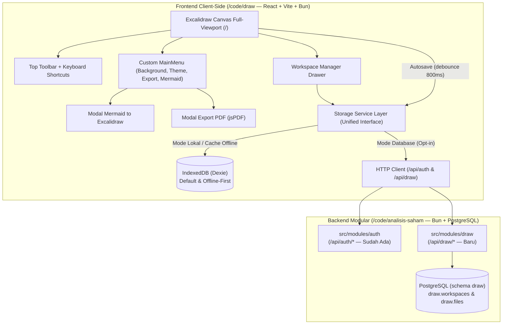

# Rencana Pengembangan Aplikasi Draw (Excalidraw Self-Hosted & Dual Storage)

> **Lokasi Frontend**: `/Users/macbook/Documents/Belajar/sahamin/code/draw`  
> **Lokasi Backend Module**: `/Users/macbook/Documents/Belajar/sahamin/code/analisis-saham/src/modules/draw`  
> **Migrasi Database**: `/Users/macbook/Documents/Belajar/sahamin/code/analisis-saham/db/migrasi/024_draw.sql`

---

## 1. Tujuan & Kebutuhan Produk

Membangun aplikasi whiteboard/diagramming **100% gratis, open-source, dan client-side first** dengan pengalaman menggambar flow yang persis seperti **Excalidraw** untuk kebutuhan workflow harian:

1. **Instant Canvas (Landing = Halaman Drawing)**: Membuka aplikasi (`/`) langsung masuk ke kanvas menggambar layar penuh tanpa halaman marketing/login blocker, otomatis memuat workspace terakhir dari **IndexedDB** dalam hitungan milidetik.
2. **Pengalaman Excalidraw Penuh**:
   - Gaya hand-drawn/flow persis Excalidraw.
   - **Top Toolbar** lengkap dengan **keyboard shortcuts** (`V`, `R`, `D`, `O`, `A`, `L`, `P`, `T`, `E`, `H`/`Space`, `Q`, `9`, `F`, `K`, `B`, `Cmd/Ctrl+F`, `Cmd/Ctrl+/`, dll.).
   - **Canvas Background** (pilihan swatch warna latar kanvas & custom color picker) + tema Terang / Gelap / Sistem.
   - **Hamburger Menu** bersih tanpa link promosi eksternal (Excalidraw+, Discord, dll.), difokuskan pada fitur produktivitas.
3. **Mermaid to Excalidraw**: Editor teks Mermaid client-side untuk langsung mengubah kode Mermaid (Flowchart, Sequence, Class, ER, State) menjadi elemen Excalidraw yang masih bisa diedit di kanvas.
4. **Export Lengkap**:
   - **PNG & SVG & Copy to Clipboard** (dengan opsi Background, Dark mode, Embed scene, Scale `1x`/`2x`/`3x`, dan nama file).
   - **Export PDF** (kualitas tinggi dengan opsi ukuran kertas Fit/A4/A3/Letter, orientasi Auto/Landscape/Portrait, Background, Dark mode, Scale, serta dukungan multi-halaman per Frame).
   - **Export / Import `.excalidraw` JSON** untuk portabilitas penuh.
5. **Dual Storage Workspace (IndexedDB + Opsi Database Backend)**:
   - **Default: Lokal (IndexedDB)** — berjalan 100% client-side, offline-first, bisa menyimpan banyak workspace/kanvas beserta gambar/aset biner dan thumbnail preview.
   - **Opsional: Database (PostgreSQL)** — terintegrasi ke backend `analisis-saham` melalui modul baru `src/modules/draw` (`/api/draw/*`) memanfaatkan autentikasi JWT lintas-app yang sudah ada (`/api/auth/*`). Pengguna bisa memilih menyimpan/sinkronisasi workspace tertentu ke database atau tetap lokal saja.

---

## 2. Riset & Pemilihan Library

### 2.1 Engine Kanvas & Diagramming

| Library                                  | Lisensi                      | Gratis Produksi / Self-Host?                              | Kemiripan dengan Excalidraw                                     | Catatan                                                                                                                                                              |
| :--------------------------------------- | :--------------------------- | :-------------------------------------------------------- | :-------------------------------------------------------------- | :------------------------------------------------------------------------------------------------------------------------------------------------------------------- |
| **`@excalidraw/excalidraw` (`^0.18.x`)** | **MIT**                      | **Ya, 100% gratis**                                       | **100% identik** (engine resmi Excalidraw)                      | Sudah mendukung React 19, Vite, Top Toolbar, Keyboard Shortcuts, Canvas Background, Export PNG/SVG/Clipboard, Frame, Laser Pointer, Command Palette, Find on Canvas. |
| `tldraw`                                 | Proprietary (tldraw License) | Tidak (produksi butuh lisensi berbayar / watermark hobby) | Berbeda gaya visual                                             | Tidak cocok untuk syarat gratis tanpa batasan produksi.                                                                                                              |
| `React Flow` (`@xyflow/react`)           | MIT                          | Ya                                                        | Node-graph terstruktur, bukan freehand whiteboard               | Cocok untuk node editor/pipeline, kurang cocok untuk sketsa flow bebas ala Excalidraw.                                                                               |
| `Konva` / `Fabric.js`                    | MIT                          | Ya                                                        | Harus bangun ulang semua tool, arrow binding, RoughJS, shortcut | Effort sangat besar untuk menyamai kualitas Excalidraw.                                                                                                              |

**Keputusan**: Menggunakan **`@excalidraw/excalidraw` (`^0.18.x`)** — satu-satunya pilihan yang memberikan pengalaman 100% persis Excalidraw secara gratis (MIT) dan berjalan sepenuhnya di sisi klien.

### 2.2 Stack Library Pendukung

| Kebutuhan                    | Library Pilihan                                                | Lisensi    | Alasan Pemilihan                                                                                                                                                                                                                |
| :--------------------------- | :------------------------------------------------------------- | :--------- | :------------------------------------------------------------------------------------------------------------------------------------------------------------------------------------------------------------------------------ |
| **Mermaid → Excalidraw**     | `@excalidraw/mermaid-to-excalidraw`                            | MIT        | Library resmi dari tim Excalidraw; menyediakan `parseMermaidToExcalidraw()` + `convertToExcalidrawElements()` untuk mengubah sintaks Mermaid jadi elemen kanvas yang dapat diedit sepenuhnya di browser.                        |
| **Export PDF**               | `jspdf`                                                        | MIT        | Ringan, 100% client-side, teruji untuk membungkus output resolusi tinggi dari `exportToBlob()` / `exportToCanvas()` Excalidraw ke PDF (A4, A3, Letter, atau ukuran custom sesuai rasio kanvas + dukungan multi-page per Frame). |
| **IndexedDB Storage**        | `dexie` + `dexie-react-hooks`                                  | Apache-2.0 | Wrapper IndexedDB modern dengan migrasi skema versi, query terindeks, penyimpanan `Blob`/binary file yang efisien, dan reactive hook (`useLiveQuery`) untuk daftar workspace real-time.                                         |
| **Ikon UI Custom**           | `lucide-react`                                                 | ISC        | Ikon konsisten & ringan untuk Workspace Drawer, Modal PDF, Modal Mermaid, indikator Sync, dan Modal Login.                                                                                                                      |
| **Frontend Build & Styling** | `React 19` + `Vite` + `TypeScript` + `Tailwind CSS v4` + `Bun` | MIT        | Konsisten dengan ekosistem `analisis-saham-fe` dan `analisis-saham`, build sangat cepat, typing penuh untuk API Excalidraw.                                                                                                     |
| **Backend Module**           | `Bun` + `TypeScript` + `PostgreSQL` (`bun` SQL) + `zod`        | —          | Mengikuti 100% stack dan arsitektur modular yang sudah ada di `analisis-saham` tanpa menambah dependensi baru di backend.                                                                                                       |

---

## 3. Arsitektur Sistem



### Prinsip Desain Utama

- **Zero-Friction Startup**: Saat `/` dibuka, app membaca `lastActiveWorkspaceId` dari `localStorage`/IndexedDB dan langsung merender `<Excalidraw />`. Tidak ada splash screen atau kewajiban login.
- **Self-Hosted Fonts & Assets (Offline-Ready)**: Font Excalidraw (`node_modules/@excalidraw/excalidraw/dist/prod/fonts`) disalin ke `public/fonts/` saat setup/build dan `window.EXCALIDRAW_ASSET_PATH = "/"` diset agar kanvas tetap berfungsi 100% offline tanpa CDN eksternal.
- **Unified Storage Abstraction**: UI tidak perlu tahu apakah workspace disimpan di IndexedDB atau PostgreSQL; semua operasi (`list`, `get`, `save`, `delete`, `duplicate`, `migrateStorage`) lewat satu layer `workspaceService`.

---

## 4. Pemetaan Fitur UI & Pengalaman Pengguna

### 4.1 Landing Page & Layout Kanvas

- Full-viewport `100vw x 100vh` (`overflow: hidden`).
- Top-left: Tombol Hamburger Menu bawaan Excalidraw.
- Top-center: Top Toolbar bawaan Excalidraw (Lock, Hand, Select `V`, Rectangle `R`, Diamond `D`, Ellipse `O`, Arrow `A`, Line `L`, Draw `P`, Text `T`, Note/Image `9`, Eraser `E`, More tools `...` berisi Insert image, Frame tool `F`, Web Embed, Laser pointer `K`, dll.).
- Top-right (`renderTopRightUI`):
  - **Badge Canvas Aktif** (judul bisa klik untuk rename cepat + nama folder + indikator status simpan: `Lokal`, `Database`, `Menyimpan...`, `Offline`).
  - **Tombol `+ New Canvas`** (1-klik langsung buat kanvas kosong baru; kanvas sebelumnya otomatis tersimpan).
  - **Tombol `My Canvas` (ikon folder)** (membuka Drawer daftar folder & semua canvas lokal maupun database).
  - **Tombol Cepat Mermaid** (ikon diagram untuk langsung buka Mermaid to Excalidraw).
  - **Tombol Export PDF** (akses 1-klik selain dari menu).

### 4.1.1 Pengalaman "My Canvas" & Manajemen Folder

Drawer **My Canvas** (bisa dibuka dari tombol folder di atas, dari Hamburger Menu, atau shortcut `Cmd/Ctrl+Shift+W`) berfungsi seperti file explorer mini untuk seluruh workflow gambar:

- **Aksi Cepat di Header Drawer**:
  - **`+ New Canvas`** (pilih langsung simpan di **Lokal IndexedDB** atau **Database**, otomatis masuk ke folder yang sedang dibuka).
  - **`+ Folder Baru`** untuk mengelompokkan proyek/workflow (mis. `Arsitektur`, `Flow Backend`, `UI Wireframe`, `Catatan`).
  - **Import `.excalidraw`** dari file komputer langsung masuk ke daftar My Canvas.
- **Navigasi Folder & Filter Penyimpanan**:
  - Sidebar/pills folder: `Semua Canvas`, `Tanpa Folder`, dan daftar folder buatan pengguna (bisa rename folder & hapus folder — canvas di dalamnya otomatis dipindah ke `Tanpa Folder` agar tidak hilang).
  - Tab filter storage: **Semua** · **Lokal (IndexedDB)** · **Database (Cloud)**.
  - Kolom pencarian berdasarkan judul canvas.
- **Kartu Canvas**:
  - Thumbnail pratinjau otomatis, judul, nama folder, badge storage (`Lokal` / `Database`), jumlah elemen, dan waktu terakhir diubah.
  - Klik kartu → langsung buka di kanvas utama (canvas sebelumnya tersimpan otomatis).
  - Menu aksi kartu: **Rename**, **Pindah Folder**, **Duplikasi**, **Simpan ke Database / Pindah ke Lokal**, dan **Hapus**.

### 4.2 Custom MainMenu (Hamburger Menu)

Menyusun ulang `<MainMenu>` agar bersih & sesuai screenshot referensi tanpa promosi eksternal:

1. **File & Workspace**:
   - Workspace Saya... (`Cmd/Ctrl+Shift+W`)
   - Buka file `.excalidraw` (`MainMenu.DefaultItems.LoadScene` — `Cmd/Ctrl+O`)
   - Simpan ke file `.excalidraw` (`MainMenu.DefaultItems.Export`)
   - Simpan ke Database / Pindah ke Lokal (toggle cepat untuk workspace aktif)
2. **Export & Generate**:
   - Export image PNG / SVG / Clipboard (`MainMenu.DefaultItems.SaveAsImage` — `Cmd/Ctrl+Shift+E`)
   - **Export PDF...** (`Cmd/Ctrl+Shift+P`)
   - **Mermaid to Excalidraw...** (`Cmd/Ctrl+Shift+M`)
3. **Alat Kanvas**:
   - Command palette (`MainMenu.DefaultItems.CommandPalette` — `Cmd/Ctrl+/`)
   - Find on canvas (`MainMenu.DefaultItems.SearchMenu` — `Cmd/Ctrl+F`)
   - Help / Daftar Shortcut (`MainMenu.DefaultItems.Help` — `?`)
   - Reset the canvas (`MainMenu.DefaultItems.ClearCanvas`)
4. **Tampilan & Akun**:
   - Theme switcher: Light / Dark / System (`MainMenu.DefaultItems.ToggleTheme`)
   - Canvas background swatches (`MainMenu.DefaultItems.ChangeCanvasBackground`)
   - Status Akun Sync Database (Login / Logout memakai akun `/api/auth/login` yang sama dengan `analisis-saham`).

### 4.3 Keyboard Shortcuts

- **Bawaan Excalidraw** (tetap aktif penuh):
  - `V` / `1` Select, `R` / `2` Rectangle, `D` / `3` Diamond, `O` / `4` Ellipse, `A` / `5` Arrow, `L` / `6` Line, `P` / `7` Freedraw, `T` / `8` Text, `9` Image, `E` / `0` Eraser, `H` Hand, `Q` Lock active tool, `F` Frame, `K` Laser pointer, `Space + Drag` Pan kanvas, `Cmd/Ctrl + Z` / `Shift+Z` Undo/Redo, `Cmd/Ctrl + F` Find, `Cmd/Ctrl + /` Command palette, `Cmd/Ctrl + Shift + E` Export PNG/SVG, `?` Help.
- **Tambahan Workflow Aplikasi**:
  - `Cmd/Ctrl + S`: Paksa simpan segera ke storage aktif (menghindari dialog Save webpage browser).
  - `Cmd/Ctrl + Shift + W`: Buka/tutup Workspace Drawer.
  - `Cmd/Ctrl + Shift + M`: Buka modal Mermaid to Excalidraw.
  - `Cmd/Ctrl + Shift + P`: Buka modal Export PDF.

### 4.4 Fitur Mermaid to Excalidraw

- Modal split-pane responsif:
  - **Panel Kiri**: Code editor Mermaid + dropdown **Template Cepat** (Flowchart, Sequence Diagram, Class Diagram, ER Diagram, State Diagram) + opsi `Elbow Arrows` & `Font Size`.
  - **Panel Kanan**: Live preview hasil render (SVG preview dari elemen hasil konversi) + pesan error sintaks yang jelas jika kode belum valid.
  - **Aksi Insert**:
    - `Tambahkan ke Kanvas` (append di posisi viewport aktif tanpa menghapus gambar lama).
    - `Ganti Isi Kanvas` (replace seluruh elemen lalu `scrollToContent` dengan `fitToContent: true`).

### 4.5 Fitur Export PNG, SVG & PDF

- **PNG / SVG / Copy to Clipboard**: Memanfaatkan dialog `SaveAsImage` bawaan Excalidraw (`exportToBlob` / `exportToSvg`) yang sudah memiliki toggle Background, Dark mode, Embed scene, Scale `1x`/`2x`/`3x`, input nama file, dan tombol PNG / SVG / Copy to clipboard.
- **Export PDF** (Modal Custom dengan Live Preview):
  - Input nama file (default: nama workspace + tanggal).
  - Toggle **Background** (sertakan warna background kanvas atau putih bersih).
  - Toggle **Dark mode**.
  - Pilihan **Scale / Kualitas**: `1x` (Ringan), `2x` (Standar Tajam — default), `3x` (Cetak HD).
  - Pilihan **Ukuran Halaman**:
    - `Fit to Canvas` (ukuran halaman PDF otomatis mengikuti dimensi diagram — ideal untuk flowchart lebar).
    - `A4`, `A3`, `Letter` dengan orientasi `Auto`, `Landscape`, atau `Portrait` + margin rapi.
  - **Multi-Page per Frame** (opsional otomatis aktif jika kanvas memiliki elemen `frame`): mengekspor setiap Frame sebagai 1 halaman PDF terpisah seperti slide/dokumentasi alur.

---

## 5. Strategi Dual Storage (IndexedDB + Database)

### 5.1 Skema IndexedDB (Dexie — `draw_local_db`)

| Object Store | Primary Key & Index                                           | Isi Data                                                                                                                                                                                                                                                                                                                                                                 |
| :----------- | :------------------------------------------------------------ | :----------------------------------------------------------------------------------------------------------------------------------------------------------------------------------------------------------------------------------------------------------------------------------------------------------------------------------------------------------------------- |
| `workspaces` | `id` (UUID), `updatedAt`, `storageMode`, `remoteId`, `folder` | `id`, `title`, `folder`, `storageMode` (`"local" \| "cloud"`), `remoteId` (UUID/null), `elements` (JSON), `appState` (subset aman: `viewBackgroundColor`, `theme`, `gridSize`, `scrollX`, `scrollY`, `zoom`), `thumbnail` (dataURL WebP/PNG kecil ~10-25 KB), `version`, `syncStatus` (`"local_only" \| "synced" \| "pending" \| "conflict"`), `createdAt`, `updatedAt`. |
| `files`      | `id` (`fileId` Excalidraw), `workspaceId`                     | `id`, `workspaceId`, `mimeType`, `dataURL` (atau `Blob`), `sizeBytes`, `createdAt`. Dipisah dari tabel `workspaces` agar query daftar workspace super cepat.                                                                                                                                                                                                             |
| `settings`   | `key`                                                         | `lastActiveWorkspaceId`, `defaultStorageMode`, `preferredExportScale`.                                                                                                                                                                                                                                                                                                   |

### 5.2 Alur Sync & Pilihan Penyimpanan

1. **Default Lokal (IndexedDB)**:
   - Setiap kanvas baru dibuat di IndexedDB (`storageMode: "local"`).
   - Autosave berjalan dengan debounce `800ms` (hanya menyimpan bila `elements` atau `appState` relevan berubah — cek menggunakan hash/version Excalidraw `getSceneVersion(elements)`).
2. **Opsi Simpan ke Database (`storageMode: "cloud"`)**:
   - Di Workspace Drawer atau Header bar, pengguna dapat klik **"Simpan ke Database"** pada workspace mana pun (atau membuat workspace baru langsung di tab "Database").
   - Jika belum login, muncul modal login ringan ke `/api/auth/login` (mendukung akun yang sudah ada di backend `analisis-saham`, termasuk auto-refresh token `/api/auth/refresh`).
   - Workspace tetap di-cache di IndexedDB sehingga membuka kanvas tetap instan dan bisa diedit saat offline, lalu disinkronkan ke backend saat online (`pending` → `synced`).
   - Pengguna juga bisa mengubah workspace Database kembali menjadi **Hanya Lokal** (opsi simpan salinan lokal / hapus dari database).
3. **Konflik Versi (Optimistic Locking)**:
   - Setiap update ke database mengirim `expected_version`. Jika server mendeteksi versi lebih baru (`409 Conflict`), UI menampilkan dialog pilihan: **Gunakan Versi Server**, **Timpa dengan Versi Lokal**, atau **Simpan sebagai Duplikat Baru**.

---

## 6. Desain Modul Backend (`analisis-saham/src/modules/draw`)

Mengikuti 100% konvensi `analisis-saham/AGENTS.md`:

- Layer: `routes → controller → service → model → view` (atau `respon.ts`).
- SQL **hanya** di `models/`, menggunakan `sql` pool bersama dari `src/core/db.ts`.
- Validasi input memakai `zod` di controller/route.
- Autentikasi menggunakan `perluAuth` dari `src/core/middleware.ts` (setiap user hanya bisa membaca/mengubah workspace miliknya sendiri berdasarkan `user.id`).
- Didaftarkan di `src/modules/index.ts` sebagai `drawModule` dengan `name: "draw"`, `prefix: "/api/draw"`.

### 6.1 Struktur Direktori Modul Backend

```text
analisis-saham/
├── db/migrasi/
│   └── 024_draw.sql
└── src/modules/
    ├── index.ts                      # Daftarkan drawModule ke allModules
    └── draw/
        ├── index.ts                  # Export drawModule: AppModule
        ├── draw.routes.ts            # Definisi route relatif terhadap /api/draw
        ├── controllers/
        │   └── workspace.controller.ts
        ├── services/
        │   └── workspace.service.ts
        ├── models/
        │   ├── workspace.model.ts    # Semua query SQL tabel draw.workspaces
        │   └── file.model.ts         # Semua query SQL tabel draw.files
        └── schemas/
            └── workspace.schema.ts   # Skema validasi Zod
```

### 6.2 Skema Database PostgreSQL (`db/migrasi/024_draw.sql` & `027_draw_schema.sql`)

```sql
-- Migrasi 027: Pemisahan schema khusus `draw` untuk workspace & aset file Excalidraw per pengguna.
CREATE SCHEMA IF NOT EXISTS draw;

CREATE TABLE IF NOT EXISTS draw.workspaces (
  id uuid PRIMARY KEY DEFAULT gen_random_uuid(),
  user_id int NOT NULL REFERENCES public.users(id) ON DELETE CASCADE,
  judul text NOT NULL DEFAULT 'Tanpa Judul',
  folder text NOT NULL DEFAULT '',
  elements jsonb NOT NULL DEFAULT '[]'::jsonb,
  app_state jsonb NOT NULL DEFAULT '{}'::jsonb,
  thumbnail text,
  versi int NOT NULL DEFAULT 1,
  dibuat timestamptz NOT NULL DEFAULT now(),
  diperbarui timestamptz NOT NULL DEFAULT now()
);

CREATE INDEX IF NOT EXISTS idx_draw_workspaces_user_diperbarui
  ON draw.workspaces (user_id, diperbarui DESC);

CREATE TABLE IF NOT EXISTS draw.files (
  workspace_id uuid NOT NULL REFERENCES draw.workspaces(id) ON DELETE CASCADE,
  file_id text NOT NULL,
  mime_type text NOT NULL,
  data_url text NOT NULL,
  ukuran_byte int NOT NULL DEFAULT 0,
  dibuat timestamptz NOT NULL DEFAULT now(),
  PRIMARY KEY (workspace_id, file_id)
);
```

### 6.3 Kontrak REST API (`/api/draw/*`)

Seluruh endpoint memerlukan header `Authorization: Bearer <access_token>` (via `perluAuth`) dan mengembalikan respons standar `{ data }` atau `{ error }`.

| Method   | Path                                 | Deskripsi                                    | Catatan                                                                                                                                                                          |
| :------- | :----------------------------------- | :------------------------------------------- | :------------------------------------------------------------------------------------------------------------------------------------------------------------------------------- |
| `GET`    | `/api/draw/workspaces`               | Daftar workspace milik user (`?q=&folder=`)  | Mengembalikan metadata + `thumbnail` + `versi` + `jumlah_elemen` (tanpa payload `elements`/`files` penuh agar ringan).                                                           |
| `POST`   | `/api/draw/workspaces`               | Buat workspace baru di database              | Body: `{ judul, folder?, elements?, app_state?, thumbnail?, files? }`. Kembalikan `201`.                                                                                         |
| `GET`    | `/api/draw/workspaces/:id`           | Ambil detail lengkap 1 workspace             | Mengembalikan `elements`, `app_state`, dan map `files` milik workspace tersebut. Cek ownership `user_id`.                                                                        |
| `PUT`    | `/api/draw/workspaces/:id`           | Update isi/metadata workspace                | Mendukung `expected_version` (optimistic lock → `409 Conflict` bila mismatch). Otomatis naikkan `versi = versi + 1` & sync `files` (upsert baru, hapus yang tidak dipakai lagi). |
| `PATCH`  | `/api/draw/workspaces/:id/meta`      | Rename judul / ubah folder saja              | Tanpa mengirim ulang `elements` besar.                                                                                                                                           |
| `POST`   | `/api/draw/workspaces/:id/duplicate` | Duplikasi workspace beserta `draw.files`     | Membuat salinan baru milik user.                                                                                                                                                 |
| `DELETE` | `/api/draw/workspaces/:id`           | Hapus workspace (cascade hapus `draw.files`) | Cek ownership `user_id`.                                                                                                                                                         |

**Batas Keamanan Payload**:

- Validasi panjang judul (maks 120 karakter), folder (maks 60 karakter).
- Batas ukuran total payload per request (mis. 15 MB) dan validasi format `data_url` gambar (`image/png`, `image/jpeg`, `image/webp`, `image/svg+xml`, `image/gif`).
- Cek kepemilikan (`WHERE id = $1 AND user_id = $2`) di setiap operasi baca/tulis/hapus.

---

## 7. Struktur Direktori Frontend (`/Users/macbook/Documents/Belajar/sahamin/code/draw`)

```text
draw/
├── PLAN.md
├── TASKS.md
├── package.json
├── tsconfig.json
├── vite.config.ts                # Port 5001, proxy /api → http://localhost:6000
├── index.html                    # Set window.EXCALIDRAW_ASSET_PATH = "/"
├── public/
│   └── fonts/                    # Self-hosted fonts disalin dari @excalidraw/excalidraw
└── src/
    ├── main.tsx
    ├── App.tsx                   # Langsung merender CanvasPage (landing = drawing)
    ├── index.css                 # Tailwind v4 + override tipis tema/UI Excalidraw
    ├── types/
    │   └── workspace.ts          # Tipe Workspace, SyncStatus, ExportPdfOptions, AuthUser
    ├── lib/
    │   ├── db.ts                 # Konfigurasi Dexie (IndexedDB)
    │   ├── api.ts                # Fetch helper (/api/auth & /api/draw) + auto-refresh JWT
    │   ├── thumbnail.ts          # Generator thumbnail ringan dari scene Excalidraw
    │   ├── exportPdf.ts          # Pipeline Export PDF (jsPDF + exportToBlob + Frame multi-page)
    │   └── mermaid.ts            # Wrapper @excalidraw/mermaid-to-excalidraw + daftar template
    ├── services/
    │   ├── authService.ts        # Login, register, logout, refresh token, sesi user
    │   ├── localWorkspace.ts     # CRUD IndexedDB via Dexie
    │   ├── cloudWorkspace.ts     # CRUD Database via /api/draw/*
    │   └── workspaceManager.ts   # Unified dual-storage manager + migrasi Lokal ↔ DB + conflict
    ├── hooks/
    │   ├── useWorkspace.ts       # Load workspace terakhir, switch, debounced autosave
    │   ├── useAuth.ts            # State autentikasi opsional untuk Cloud DB
    │   └── useHotkeys.ts         # Custom shortcuts (Cmd+S, Cmd+Shift+M/P/W)
    └── components/
        ├── CanvasBoard.tsx       # Wrapper <Excalidraw /> + custom <MainMenu /> + TopRightUI
        ├── TopRightControls.tsx  # Judul inline, status sync, tombol Workspace / Mermaid / PDF
        ├── WorkspaceDrawer.tsx   # Panel manajemen workspace (tab Semua / Lokal / Database)
        ├── MermaidModal.tsx      # Modal Mermaid to Excalidraw (editor + template + preview)
        ├── ExportPdfModal.tsx    # Modal Export PDF (preview + ukuran kertas + scale + frame)
        ├── AuthModal.tsx         # Modal Login/Register saat user memilih simpan ke Database
        └── ConflictModal.tsx     # Dialog resolusi konflik versi saat sync Database
```

---

## 8. Risiko Teknis & Mitigasi

| Risiko                                                                    | Dampak                                                    | Mitigasi                                                                                                                                                                                              |
| :------------------------------------------------------------------------ | :-------------------------------------------------------- | :---------------------------------------------------------------------------------------------------------------------------------------------------------------------------------------------------- |
| **Font Excalidraw gagal dimuat saat offline**                             | Teks fallback ke Arial, kehilangan estetika hand-drawn    | Salin aset font dari `node_modules/@excalidraw/excalidraw/dist/prod/fonts` ke `public/fonts` lewat script `postinstall`/build dan set `window.EXCALIDRAW_ASSET_PATH = "/"`.                           |
| **`onChange` Excalidraw terpanggil sangat sering (setiap gerak pointer)** | Lag atau penulisan IndexedDB / API berlebihan             | Gunakan `getSceneVersion(elements)` + komparasi subset `appState` (`viewBackgroundColor`, `theme`, `gridSize`) + debounce `800ms` (lokal) dan `2000ms` (cloud).                                       |
| **Memory leak saat preview/export PDF & SVG**                             | Browser melambat pada diagram besar                       | Selalu panggil `URL.revokeObjectURL()` di `finally`, dan bersihkan elemen `<canvas>` sementara setelah ekspor selesai.                                                                                |
| **CORS saat frontend (`:5001`) akses backend (`:6000`)**                  | Request `/api/draw` diblokir browser                      | Gunakan Vite dev proxy `/api -> http://localhost:6000` (sama seperti `analisis-saham-fe`). Untuk deploy terpisah di produksi, siapkan reverse proxy satu origin atau header CORS opsional di backend. |
| **Bentrok shortcut browser (`Cmd+S`, `Cmd+P`)**                           | Dialog save/print browser muncul saat user tekan shortcut | Intercept `keydown` secara aman (`preventDefault`) hanya saat tidak sedang mengetik di `<input>` / `<textarea>` modal.                                                                                |
| **Payload besar jika banyak gambar tertanam**                             | API lambat saat save ke DB                                | Pisahkan tabel `draw.files` dari `draw.workspaces` dan hanya kirim/sinkronkan file yang berubah atau belum ada, serta gunakan thumbnail kompresi WebP ukuran kecil untuk daftar workspace.            |
